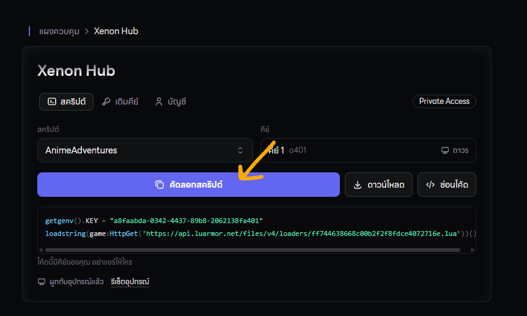

กดปุ่ม Get Script  และเลือกสคริปต์แมพที่ต้องการจะใช้งาน

## ทำตามขั้นตอนด้านล่างนี้ได้เลย

กดปุ่มสคริปต์ในเว็ปไซต์ของเรา [https://xenonhub.pro/xenonpanel](https://xenonhub.pro/xenonpanel)

<Check>
  [คลิ๊กที่ข้อความนี้เพื่ออ่านขั้นตอนการเติมคีย์](/redeem-key)
</Check>

หากคัดลอกสคริปต์มาแล้ว มี 4 บรรทัดเหมือนภาพนี้ ให้ลบออกไปด้วย หากไม่มีก็ไม่ต้องลบออก

