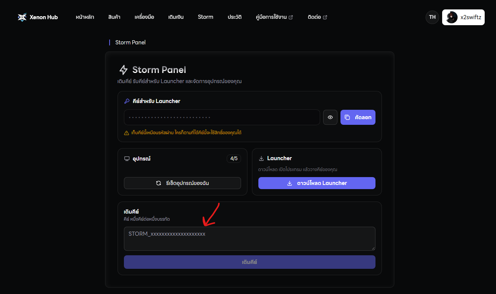
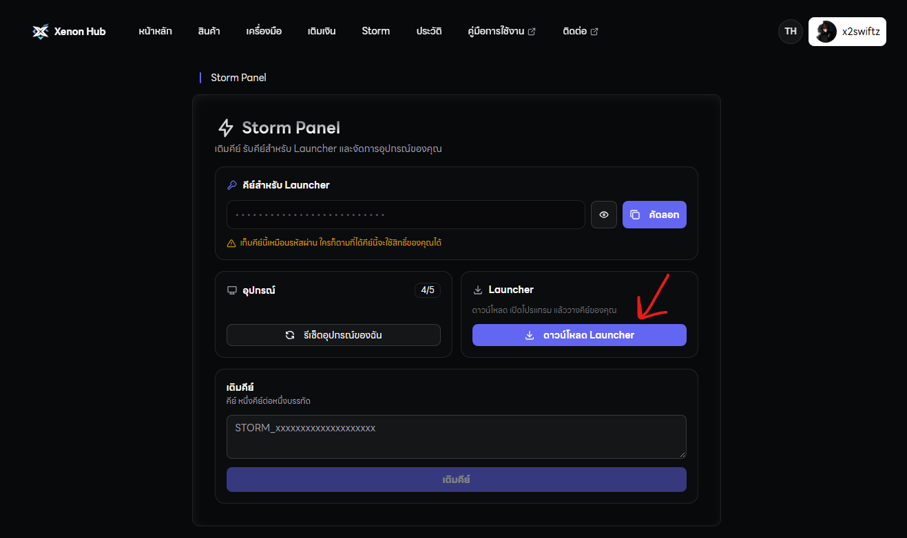
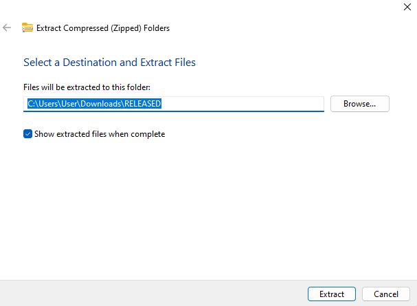
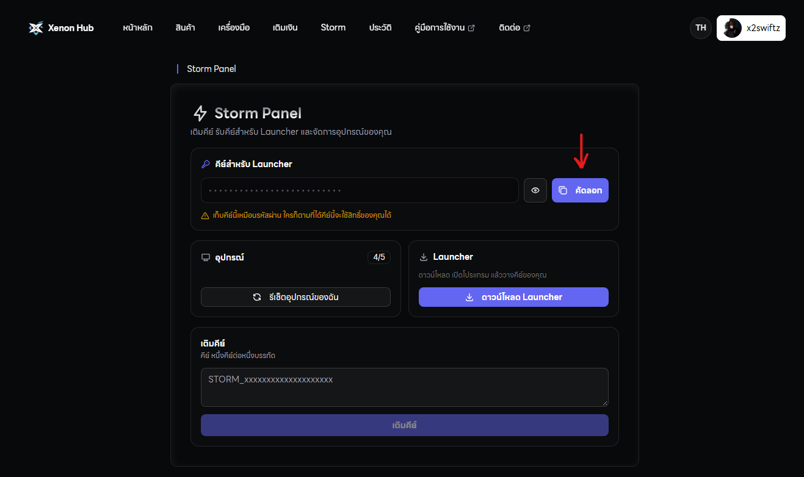

## 🗝️ เริ่มต้นใช้งาน

ให้ทำตาม Step ด้านล่างนี้ และ**อย่าข้ามขั้นตอนเด็ดขาด**

<Warning>
  **คำเตือน:** โปรแกรมนี้ใช้ได้แค่บนคอมเท่านั้น ไม่รองรับกับมือถือและแอพจำลอง
</Warning>

## 🌐 สำหรับคนที่ซื้อคีย์จากเว็ปไซต์

<Steps>
  <Step title="ซื้อคีย์ Storm ผ่านเว็บไซต์">
    1 คีย์ ⇒ ต่อ 1 เครื่อง จะเปิดกี่จอก็ได้ในเครื่องนั้น ราคาคีย์ละ 199 บาท / ถาวร
  </Step>
  <Step title="เข้าดิสคอร์ด Xenon Hub">
    \>\> [คลิ๊กที่นี่เพื่อเข้าดิสคอร์ด](https://discord.gg/xenonhub) \<\< 

    หลังจากเข้าดิสคอร์ดและยืนยันตัวตนเรียบร้อยแล้ว ให้หาห้อง `🌩️・𝗦𝘁𝗼𝗿𝗺-𝗣𝗮𝗻𝗲𝗹`

    
  </Step>
  <Step title="ไปที่ Storm Panel">
    คัดลอกคีย์ที่ได้จากประวัติการซื้อ มาเติมคีย์ด้านล่างนี้ และกดเติมคีย์ได้เลย

    
  </Step>
  <Step title="กดปุ่ม Download">
    เพื่อใช้งานโปรแกรมของเราได้เลย

    `API Key:` คีย์ของคุณ

    `Max HWID:` จำนวนเครื่องที่ใช้งานได้

    
  </Step>
  <Step title="แตกไฟล์ Storm Launcher">
    ห้ามเปิดไฟล์และใช้งาน หากคุณยังไม่กด Extract Files เด็ดขาด

    
  </Step>
  <Step title="เปิดไฟล์ RUN.bat">
    จากนั้นเอา API Key ของคุณใส่ลงไป

    
  </Step>
</Steps>

## 🪜 ขั้นตอนถัดไป

ตอนนี้คุณได้เปิดใช้งานคีย์เป็นที่เรียบร้อยแล้ว ต่อไปเริ่มต้นใช้งานโปรแกรม Storm กัน

<CardGroup cols={2}>
  <Card title="Start Setup" icon="pen-to-square" horizontal href="/get-started">
    คลิ๊กที่นี่ เพื่อเริ่มต้นใช้งานโปรแกรม
  </Card>
</CardGroup>
