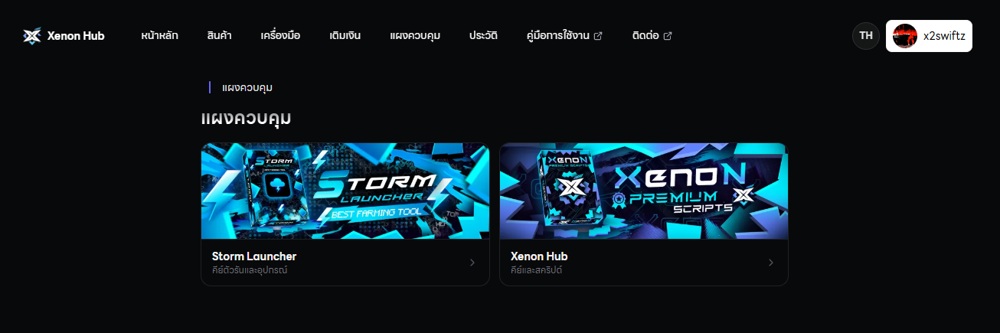
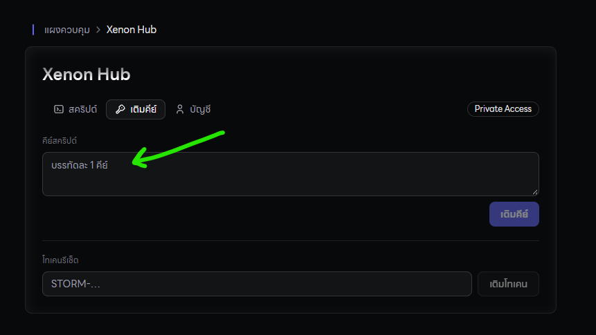
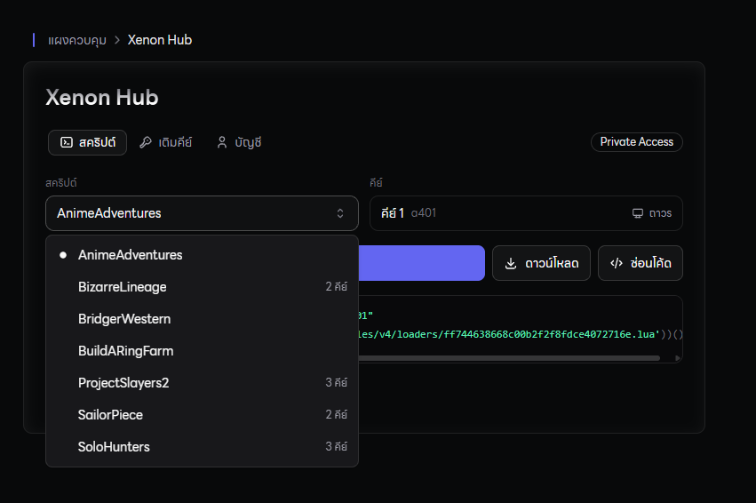
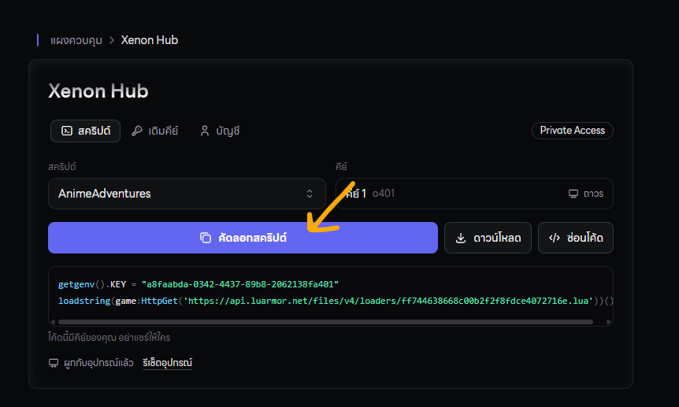
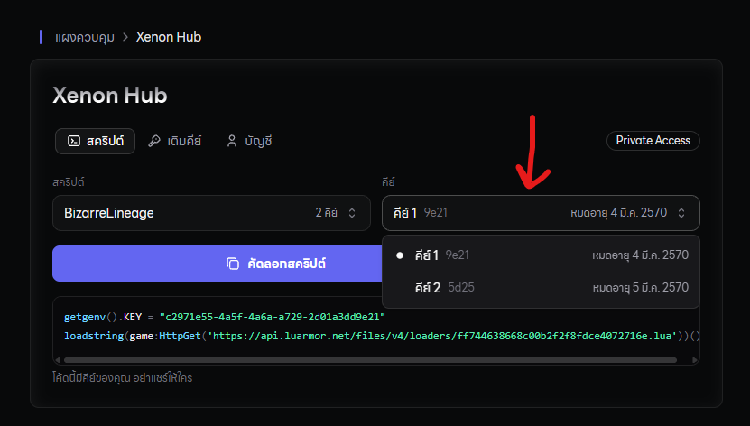

## ทำตามขั้นตอนด้านล่างนี้ได้เลย

<Steps>
  <Step title="**เข้าดิสคอร์ดของเรา**">
    [http://discord.gg/xenonhub](http://discord.gg/xenonhub)
  </Step>
  <Step title="**ยืนยันตัวตนให้เรียบร้อย**">
    กด ✅ เพื่อยืนยันตัวตนและรับยศเข้าดิสคอร์ดเรา และหากมีคำถามใดๆ ให้ติดต่อแอดมินผ่านระบบ Ticket 
  </Step>
  <Step title="**เข้าเว็ปไซต์ของเรานี้เลย**">
    ไปที่แท็บ แผงควบคุม และเลือก Xenon Hub

    
  </Step>
  <Step title="กดปุ่ม เติมคีย์">
    และกรอกคีย์ที่ได้ซื้อมาจากเว็ปไซต์ลงไปในช่องที่ให้กรอกได้เลย จากนั้นกดเติมคีย์ได้เลย

    
  </Step>
  <Step title="หลังจาก Redeem Key เรียบร้อยแล้ว">
    ให้กลับไปที่หน้าสคริปต์ และเลือกแมพที่ต้องการจะใช้ จากนั้นกดคัดลอกสคริปต์เอาไปใช้งานได้เลย

    

    
  </Step>
</Steps>

## 🤔 ถ้าจะ Redeem Key แมพเดิมอีกอันได้มั้ย?

ได้ครับ หากเติมคีย์เรียบร้อยแล้ว ก็จะมีคีย์ให้เลือกเลย ว่าจะเอาคีย์ไหนไปใช้งาน

> **1 คีย์ = 1 เครื่อง (จะเปิดกี่จอก็ได้ในเครื่องนั้น)**

