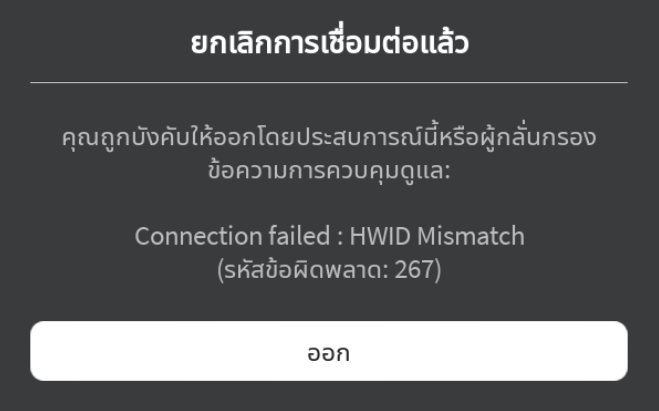
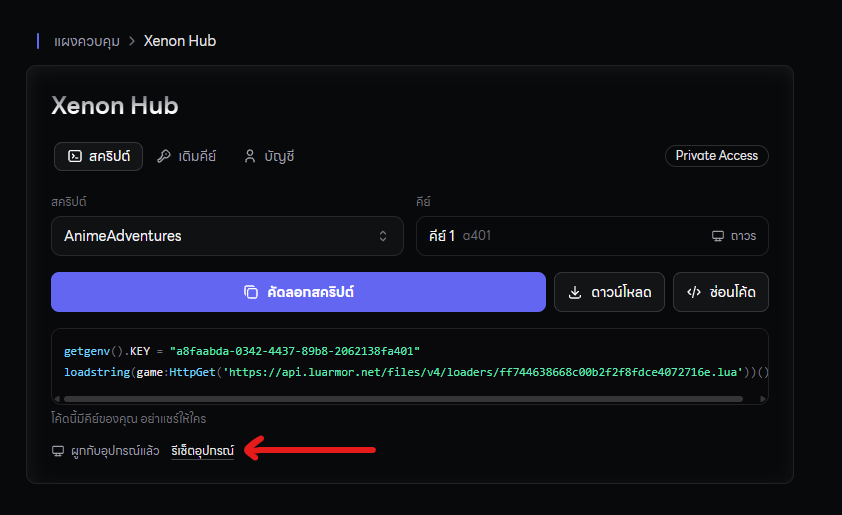
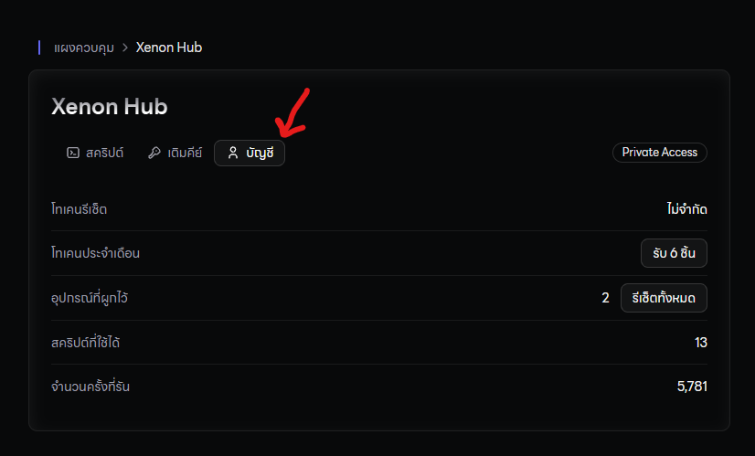
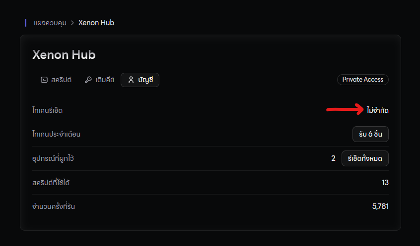

## **อะไรคือ HWID**

โดยปกติแล้ว 1 สคริปต์ จะใช้ได้ 1 เครื่องครับ ถ้าหากคุณเปลี่ยนตัวรัน หรือเปลี่ยนเครื่องที่ใช้งานแล้วเอาไปรันสคริปต์ มันจะขึ้นข้อความตามด้านล่างนั่นเองครับ

### **เพื่อให้ใช้งานกับอีกเครื่องนึงได้..**

ให้กดปุ่ม Reset HWID ที่บอทได้เลย

ก่อนกด Reset HWID คุณต้องรู้ก่อนว่าถ้ากดไปแล้ว มันจะเสีย 1 Token ครับ โดยปกติแล้วคุณจะมีเริ่มต้นอยู่ที่ 0 Tokens ถ้า Token หมดมันจะไม่สามารถ Reset HWID ได้นะครับ ต้องไปกด Claim Monthly จะได้รับฟรี 1 Token ในทุกๆ 1 เดือนครับ หรือสามารถซื้อเพิ่ม โดยสามารถซื้อผ่านแอดมินได้เลย

<Warning>
  หากกดแล้วขึ้นแบบตามภาพด้านล่างนี้ แสดงว่า Tokens ของคุณหมดแล้วนะครับ
</Warning>

### **⚠️  วิธีเช็ค Tokens คุณเหลือเท่าไหร่?**

ให้กดไปที่หน้า บัญชีในเว็ปไซต์ของเราได้เลย

